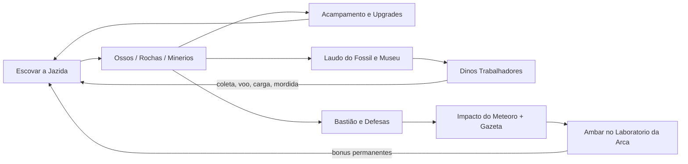
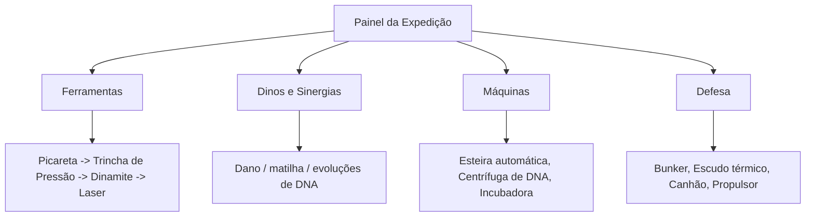

# Fóssil Rush — Documento de Design (Identidade Paleontológica)

> **Pitch em uma frase:** escove jazidas em corte geológico vertical, revele silhuetas de fósseis com **Laudo do Fóssil** no Museu, **ressuscite dinossauros trabalhadores** com funções próprias e evacue o acervo no **Laboratório da Arca** antes que **o meteoro caia**. Quando ele impacta, tudo recomeça com mais Âmbar fossilizado.

Nomes alternativos: *Extinction Protocol*, *Amber Dig*, *Projeto Arca*, *Cratera & Âmbar*.

---

## 1. O loop do jogo em 3 escalas

| Escala | Duração | O que o jogador faz |
|---|---|---|
| **Micro** (segundos) | 1–10 s | Choca o Ovo de Âmbar inicial, escova o sedimento da jazida com arrasto ou cinzel, revela silhuetas e vê ossos/fósseis no Laudo |
| **Médio** (uma run) | 10–30 min | Desce o perfil vertical camada a camada (câmera acompanha a trincheira), acerta o sismógrafo de **Golpe Preciso**, ergue tendas no Acampamento de Campo e organiza a equipe de dinossauros |
| **Macro** (meta) | horas | Recebe a **Gazeta do Cratera** no impacto, investe Âmbar no **Laboratório da Arca**, completa o acervo no Museu e se prepara para o confronto final |



---

## 2. Recursos

| Recurso | Ícone Pixel Art | Como ganha | Para que serve |
|---|---|---|---|
| **Ossos** | Osso marfim | Escovando e cinzelando a jazida | Ferramentas, clonar e montar esqueletos |
| **Rochas** | Bloco estratificado | Quebrando camadas e jazidas | Expandir e aprimorar estações do Acampamento de Campo |
| **Minérios** | Cristal turquesa | Camadas mais fundas, transporte aéreo | Ferramentas avançadas, máquinas e escudo |
| **Fragmentos de fóssil** | Placa amonite + Laudo | Encontrados ao escovar fósseis com classificação Comum a Lendário | **Laudo do Fóssil**, coleção do Museu e reviver dinos |
| **DNA** | Dupla-hélice bio-âmbar | Dinos vivos em atividade geram passivamente | Evoluir e combinar sinergias entre espécies |
| **Âmbar** | Gota translúcida dourada | **No impacto do meteoro** (evacuação pela Cápsula da Arca) | Projetos permanentes do **Laboratório da Arca** |

> Os números crescem de forma exponencial usando `float` de 64 bits da engine.

---

## 3. A escavação: corte geológico vertical e Superfície

O jogo alterna dois cenários verticais:
1. **Superfície — Acampamento de Campo**: abriga o **Ovo de Âmbar Primordial** inicial (que revela e desperta o primeiro Compsognato) e 4 estações de expedição reconstruíveis com **Rochas** (`Tenda de Ferramentas`, `Incubadora de Campo`, `Laboratório Estratigráfico` e `Bastião Anti-Impacto`).
2. **Subsolo — Corte Geológico Vertical**: perfil estratigráfico completo onde a câmera desce a cada camada vencida, mantendo **as camadas anteriores escavadas visíveis acima** com escoras de madeira, escadas de corda e nichos vazios.

| Camada | Era | Dureza | Novidade |
|---|---|---|---|
| 1 | **Terra (Crosta)** | 1x | Tutorial, sedimentos, ossos e rochas |
| 2 | **Pedra** | 10x | Fragmentos de T-Rex e Tricerátopo, fósseis raros |
| 3 | **Rocha Incandescente** | 100x | Pterodáctilo, Braquiossauro, jazidas termais |
| 4 | **Magma** | 1.000x | Anquilossauro, Dilofossauro, minério pesado |
| 5 | **Núcleo** | 10.000x | Segredo profundo da crosta terrestre |

- **Escovar a Jazida**: arrastar o cursor limpa o sedimento por distância percorrida com rastro de poeira e revela gradualmente **silhuetas de fósseis soterrados** sob a placa ativa.
- **Dial "Golpe Preciso"**: ao quebrar uma camada, um sismógrafo analógico oferece uma janela curta de bônus (acertar multiplica o golpe inicial na camada seguinte; errar nunca remove progresso).

---

## 4. Os dinossauros (trabalho visível e personalidade)

Cada espécie revivida no Museu e no painel possui sprite pixel art próprio e executa uma função física clara no perfil geológico:

| Dino | Papel | Ação visível na trincheira | Sinergia principal |
|---|---|---|---|
| **Compsognato** | Coletor | Corre até a jazida e transporta feixes visíveis de ossos até o guincho | Matilha acelera coleta e dano leve |
| **T-Rex** | Quebrador pesado | Passo pesado com mordidas esmagadoras verticais | Crítico alto em estratos densos |
| **Tricerátopo** | Impacto de área | Abaixa os chifres e empurra blocos fendidos ao longo da bancada | Dano em área no veio ativo |
| **Velociraptor** | Veloz / Caça | Investidas rasantes com rasgos triplos de garra | Escala por matilha com Compsognato |
| **Pterodáctilo** | Transporte aéreo | Voa na cota superior levando cristais de minério brilhantes | Coleta aérea contínua |
| **Braquiossauro** | Suporte | Ergue o longo pescoço emitindo ondas douradas de ressonância | Buff global de produção e dano |
| **Anquilossauro** | Defesa | Firme nas bordas, apara escombros do teto na couraça e gira a clava | Conecta escavação ao escudo anti-meteoro |
| **Dilofossauro** | Elemental | Abre a gola e cospe jatos parabólicos de ácido bio-âmbar | Dano contínuo que amolece rocha dura |

**Progressão de cada espécie:**
- **Quantidade:** clonar mais exemplares (custo exponencial + cota de fósseis).
- **Evoluções e Marcos:** atingir marcos dobra a produção da espécie.
- **Catalogação no Museu:** cada fóssil dropado recebe um **Laudo Paleontológico** com carimbo de raridade (*Comum*, *Incomum*, *Raro*, *Holótipo Lendário*) e entra nas vitrines do **Museu**.

---

## 5. Upgrades: painéis de campo por run

Organizados em abas com ícones pixel art próprios no painel lateral:



**Fórmula base de custo:**

$$\text{custo}(n) = \text{base} \times \text{crescimento}^{\,n}$$

---

## 6. O Meteoro, Manchete Pré-Histórica e Laboratório da Arca

- Durante a expedição, o meteoro é exibido **em coordenadas relativas à câmera/cenário** no céu da Superfície (e como clarão de cinzas e tremor sísmico na boca do poço quando no subsolo), acompanhado por tambor sísmico que acelera nos momentos finais.
- Quando o tempo zera ou o jogador aciona a **Evacuação Antecipada da Arca** para cristalizar seu Âmbar acumulado, o impacto dispara a edição extra da **Gazeta do Cratera** (manchete pré-histórica com o resumo da expedição) seguida pelo **Laboratório da Arca**.

### Projetos Permanentes no Laboratório da Arca
| Ramo | Exemplos |
|---|---|
| **Telemetria Orbital** | +1 min no cronômetro da Arca |
| **Paleontologia** | Fósseis mais frequentes, multiplicador de ossos |
| **Perfuração Profunda** | Dano base permanente capaz de romper a Crosta Terrestre |
| **Projeto Arca** | Propulsores e escudos definitivos para sobreviver ao grande impacto |

---

## 7. Final do jogo

O jogo possui desfecho narrativo e estrutural próprio:
- Ao completar as peças do **Projeto Arca** no Laboratório de Âmbar e atravessar todas as camadas até o Núcleo, a expedição converte o cataclismo em triunfo científico, preservando o ecossistema pré-histórico.

---

## 8. Ritmo esperado (meta de balanceamento)

| Momento | Tempo real | Marco |
|---|---|---|
| 1ª run | ~10 min | Choca o Ovo de Âmbar, escova a Crosta, cataloga fósseis no Museu |
| Runs 2–5 | ~1 h | Investe no Laboratório da Arca, desbloqueia T-Rex, Tricerátopo e Pedra |
| Runs 6–15 | ~3–4 h | Atravessa Rocha Incandescente e Magma com sinergias de 8 espécies |
| Final | ~6–10 h | Laboratório da Arca completo e ruptura definitiva do Núcleo |

---

## 9. Paleta e Identidade Visual ("Âmbar Fossilizado")

- **Paleta progressiva nunca monocromática**: toda partida abre em **sépia quente e âmbar translúcido** (pergaminho, mogno e resina dourada), ganha tonalidades de **selva pré-histórica viva** (esmeralda e samambaia) conforme a profundidade cresce, e aquece para **brasa e laranja-vermelho incandescente** quando o meteoro se aproxima — tudo centralizado em `AmberPalette` (`amber_palette.tres`) e `ui_theme.tres`.
- **Pixel art autoral**: sprites das 8 espécies, ícones de recursos/ferramentas e ornamentos sem dependência de emojis do sistema.
- **Áudio procedural responsivo**: estalos de cinzel, escovação em areia, carimbo do Laudo no Museu, acorde de Golpe Preciso e tambor sísmico crescente.

---

## 10. Arquitetura na Godot 4.7+

**Versão-alvo:** Godot 4.7+.

```
projeto-banger/
├── project.godot
├── docs/GDD.md
├── autoload/            # Singletons globais
│   ├── GameState.gd     # Recursos, números, estado da run
│   ├── SaveManager.gd   # Save/load JSON + progresso offline
│   └── Events.gd        # Signal bus desacoplado
├── data/                # Resources (.tres) de balanceamento
├── scenes/
│   ├── main/            # Cena principal e viewport vertical
│   ├── surface/         # Acampamento de Campo e Ovo de Âmbar
│   ├── dig_site/        # Corte geológico vertical, escovação, sismógrafo e VFX
│   ├── dinos/           # MultiMesh + ações visíveis por papel
│   ├── meteor/          # Meteoro relativo à câmera, Gazeta e Laboratório da Arca
│   └── ui/              # Theme âmbar, paleta, HUD, cards, Laudo e Museu
└── assets/              # sprites pixel art, ícones, fontes
```
