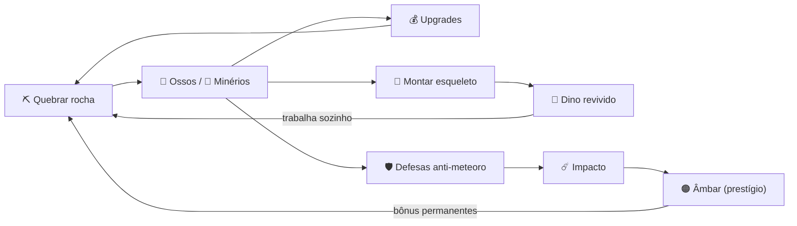
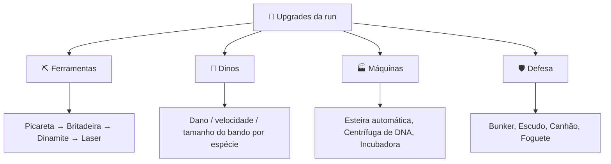
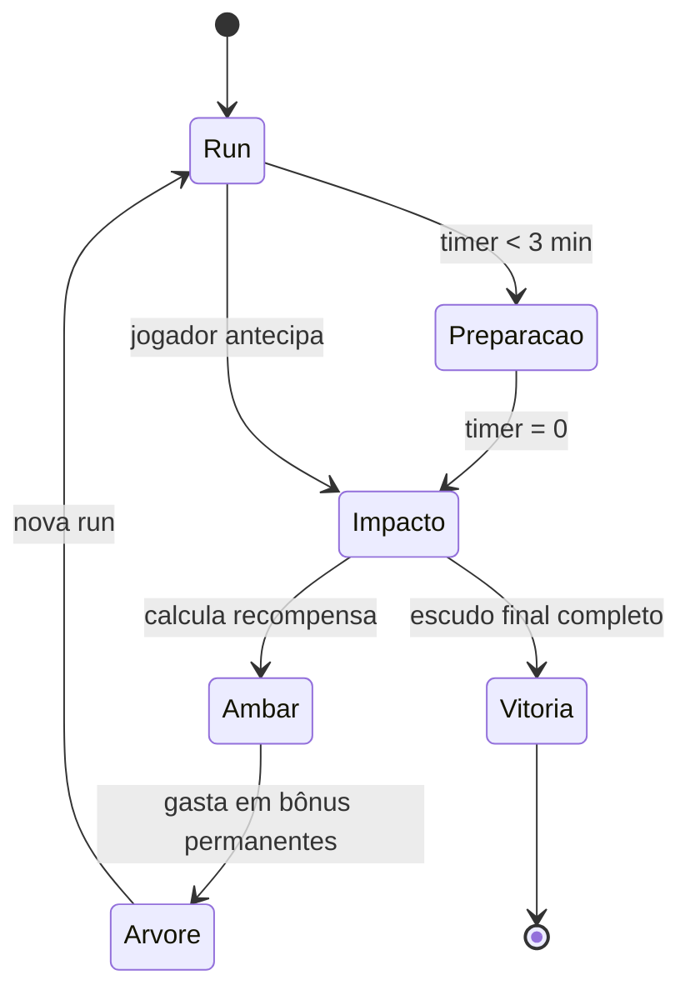
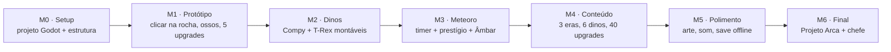

# 🦖 Conceito: "Fóssil Rush" (nome provisório)

> **Pitch em uma frase:** escave eras geológicas, junte fósseis, **ressuscite dinossauros** para trabalharem para você e construa defesas antes que **o meteoro chegue**. Quando ele cair, tudo recomeça, mais forte.

Nomes alternativos: *Extinction Protocol*, *Dig Before Doom*, *Jurassic Grind*, *Bones & Boom*, *Meteorito*.

---

## 1. O loop do jogo em 3 escalas

| Escala | Duração | O que o jogador faz |
|---|---|---|
| **Micro** (segundos) | 1–10 s | Clica na rocha, vê ossos voando, compra um upgrade barato |
| **Médio** (uma run) | 10–30 min | Desce camadas, monta dinos, prepara a defesa contra o meteoro |
| **Macro** (meta) | horas | Gasta Âmbar (prestígio) em bônus permanentes, desbloqueia eras e espécies, e busca o final do jogo |



---

## 2. Recursos

| Recurso | Ícone | Como ganha | Para que serve |
|---|---|---|---|
| **Ossos** | 🦴 | Quebrando rocha (o principal) | Upgrades básicos, contratar escavadores |
| **Minérios** | 💎 | Camadas mais fundas, chance por golpe | Ferramentas, máquinas, defesas |
| **Fragmentos de fóssil** | 🧩 | Raros, um tipo por espécie (ex.: "Crânio de T-Rex") | **Montar esqueletos**, ou seja, reviver dinos |
| **DNA** | 🧬 | Dinos vivos geram passivamente | Evoluir e melhorar dinos |
| **Âmbar** | 🟠 | **Só no impacto do meteoro** (prestígio) | Árvore permanente (sobrevive entre runs) |

> Os números crescem de forma exponencial. A Godot usa `float` de 64 bits (até cerca de 1e308), o que deve bastar. Se passar disso, criamos uma classe `BigNumber` (mantissa + expoente).

---

## 3. A escavação: eras geológicas

A tela mostra um **corte lateral do solo** (como um formigueiro). Cada camada é uma era, com rocha mais dura e recompensas melhores:

| Camada | Era | Dureza | Novidade |
|---|---|---|---|
| 1 | **Holoceno** (superfície) | 1× | Tutorial, só ossos |
| 2 | **Cretáceo** | 10× | Fragmentos de T-Rex, Tricerátopo, Velociraptor |
| 3 | **Jurássico** | 100× | Braquiossauro, Estegossauro, Pterodáctilo |
| 4 | **Triássico** | 1.000× | Espécies primitivas, minério raro |
| 5 | **Permiano** | 10.000× | Pré-dinossauros, relíquias |
| 6 | **Núcleo** ??? | ??? | Segredo do final do jogo |

- Cada camada tem uma **barra de vida**. Quando zera, ela se parte e a câmera desce, o que é um momento de recompensa visual.
- Algumas camadas têm **veios especiais** (âmbar fossilizado, ninhos de ovos) que dão bônus temporários se forem quebrados.

---

## 4. Os dinossauros (o coração do jogo)

Monte um esqueleto juntando N fragmentos de uma espécie. O dino **ganha vida** e passa a trabalhar sozinho na tela. Cada espécie tem um **papel**:

| Dino | Papel | Comportamento na tela | Sinergia exemplo |
|---|---|---|---|
| 🦎 **Compsognato** | Coletor | Corre em bando pegando ossos do chão | +bando = +velocidade de coleta |
| 🦖 **T-Rex** | Quebrador pesado | Mordidas lentas com dano enorme | Crítico ×10 em camadas duras |
| 🦕 **Tricerátopo** | Investida | Dá chifradas que empurram a rocha (dano em área) | Atordoa a rocha (+dano para todos) |
| 🐉 **Velociraptor** | Rápido / caça | Muitos golpes rápidos e fracos | Ganha bônus a cada raptor extra (matilha) |
| 🦅 **Pterodáctilo** | Transporte aéreo | Voa levando minério até o acampamento | Coleta itens que caíram longe |
| 🦕 **Braquiossauro** | Suporte | Fica parado, dá buff em área (+% produção) | Escala com o nº de dinos perto dele |
| 🛡️ **Anquilossauro** | Defesa | Golpe de cauda; **reduz o dano do meteoro** | Liga escavação e defesa |
| 🔥 **Dilofossauro** | Elemental | Cospe veneno (dano ao longo do tempo) | Combina com os upgrades de "ácido" |

**Progressão de cada espécie:**
- **Quantidade:** comprar mais unidades (custo exponencial).
- **Nível:** gastar DNA para melhorar status.
- **Mutação** (desbloqueio por Âmbar): variantes como *T-Rex Albino* (crítico) ou *Raptor Emplumado* (velocidade).

> É daqui que nascem as **builds**: uma run "matilha de raptors", outra "T-Rex crítico", outra "Braquio + muito Compy"...

---

## 5. Upgrades: árvores por run

Ficam em um painel lateral, divididos em abas:



**Tipos de upgrade (para variar):**
1. **Lineares:** +10% de dano (comprados várias vezes, custo cresce).
2. **Marcos:** ao ter 25, 50 ou 100 de um dino, a produção dele dobra.
3. **Sinergias:** "Raptors causam +1% de dano por Compsognato vivo".
4. **Desbloqueios:** nova mecânica (ex.: *Dinamite*, que limpa uma área a cada 30 s).
5. **Escolha excludente** (opcional): escolher entre *Fogo* ou *Gelo* na run, para dar replay.

**Fórmula base de custo** (padrão de incrementais):

$$\text{custo}(n) = \text{base} \times \text{crescimento}^{\,n}$$

com crescimento entre 1,07 e 1,15 dependendo do upgrade.

---

## 6. ☄️ O meteoro: contagem regressiva + prestígio (vindo da ideia 4)

Aqui a ideia 4 vira o **ritmo** do jogo:

- Toda run começa com um **meteoro visível no céu**, que vai crescendo, e um **timer** (ex.: 15:00).
- Você pode gastar recursos para **atrasar** o meteoro (radar, desvio parcial) ou para **se proteger** (bunkers, escudos).
- No impacto: explosão, tela branca, e o **Âmbar** é calculado com base em:
  - Profundidade alcançada.
  - Dinos vivos protegidos nos bunkers.
  - Escudo restante (quanto do impacto você "aguentou").
- **Opção estratégica:** o jogador pode **chamar o meteoro antes da hora** se achar que já vale a pena reiniciar (como o "compress" do Gnorp).



### Árvore de Âmbar (permanente)
| Ramo | Exemplos |
|---|---|
| ⏳ **Tempo** | +1 min no timer, começar a run com dinos já montados |
| 🦴 **Paleontologia** | +% ossos, fragmentos mais comuns, montar com menos peças |
| 🧬 **Genética** | Desbloquear mutações, DNA passivo offline |
| 🦖 **Bestiário** | Desbloquear espécies novas (Espinossauro, Mosassauro...) |
| 🚀 **Projeto Arca** | Partes do **foguete/escudo final** (ver Final do jogo) |

---

## 7. Final do jogo

O jogo tem fim (como o Gnorp):
- Ao longo das runs você constrói o **Projeto Arca** (peça por peça na árvore de Âmbar).
- Com ele completo, o meteoro vira um **"chefe final"**: uma run especial em que você precisa **destruí-lo** com tudo que juntou (dinos atacando o céu, canhões, foguete).
- Vencendo: cena final, os dinossauros **não foram extintos**, e liberamos um **modo infinito** e/ou o segredo da camada **Núcleo**.

---

## 8. Ritmo esperado (meta de balanceamento)

| Momento | Tempo real | Marco |
|---|---|---|
| 1ª run | ~10 min | Chega ao Cretáceo, monta o 1º Compsognato, perde para o meteoro (proposital) |
| Runs 2–5 | ~1 h | Descobre a árvore de Âmbar, T-Rex e Tricerátopo |
| Runs 6–15 | ~3–4 h | Jurássico e Triássico, builds diferentes, mutações |
| Final | ~6–10 h | Projeto Arca completo, batalha contra o meteoro |

---

## 9. Estilo visual e áudio (sugestão)

- **Minimalista com cor que vai aparecendo** (a mesma lógica do Gnorp): o mundo começa em tons de terra e cinza, e cada dino ou upgrade traz mais cor.
- **Alternativa:** pixel art 32×32 (dá para usar assets prontos do itch.io no começo).
- Céu que vai **avermelhando** conforme o meteoro se aproxima, o que gera tensão visual.
- Áudio: "tocs" satisfatórios nos golpes, rugidos curtos ao reviver, música que acelera nos últimos minutos.

---

## 10. Arquitetura na Godot 4 (visão geral)

```
projeto-banger/
├── project.godot
├── docs/GDD.md
├── autoload/            # Singletons globais
│   ├── GameState.gd     # Recursos, números, estado da run
│   ├── SaveManager.gd   # Save/load JSON + progresso offline
│   └── Events.gd        # Signal bus (comunicação desacoplada)
├── data/                # Resources (.tres) → balanceamento sem mexer em código
│   ├── dinos/           # trex.tres, raptor.tres...
│   ├── upgrades/
│   └── eras/
├── scenes/
│   ├── main/            # Cena principal
│   ├── dig_site/        # Camadas, rocha, partículas
│   ├── dinos/           # Cena base de dino + comportamentos
│   ├── meteor/          # Timer, céu, impacto
│   └── ui/              # Painéis de upgrade, HUD, árvore de Âmbar
└── assets/              # sprites, sons, fontes
```

**Decisões importantes:**
- **Dados em `Resource` (.tres):** dinos, upgrades e eras são arquivos de dados, então balancear é editar números, sem mexer em código. Também dá menos conflito no Git.
- **Signal bus (`Events.gd`):** a UI não depende dos dinos e vice-versa, então vocês dois mexem em partes diferentes sem se atrapalhar.
- **Performance:** quando houver centenas de dinos e milhares de ossos, usar `MultiMeshInstance2D` e `GPUParticles2D` em vez de um nó por objeto.

---

## 11. Divisão de trabalho sugerida

| 👤 Você | 👤 Gabriel |
|---|---|
| `GameState`, economia, fórmulas | Cena da escavação (camadas, rocha, câmera) |
| Sistema de upgrades + UI dos painéis | Dinos: comportamento, animação, IA simples |
| Meteoro, timer, prestígio, árvore de Âmbar | Partículas, efeitos, "game feel" (screen shake etc.) |
| Save/load + progresso offline | Arte e áudio (ou integração de assets) |

> Cada um trabalha numa **branch** própria (`feat/economia`, `feat/dinos`...) e junta via **Pull Request** no GitHub.

---

## 12. Roadmap



**MVP (até o M3)** = uma run completa e jogável: cavar, reviver 2 dinos, comprar upgrades, o meteoro cai, ganhar Âmbar, recomeçar mais forte. Já dá para mostrar para os amigos.
